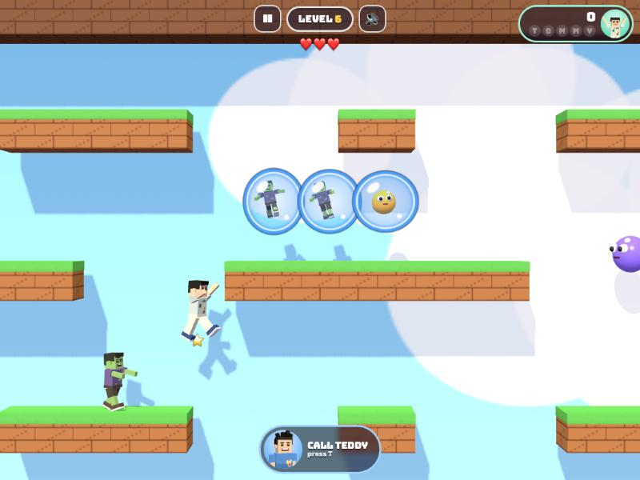
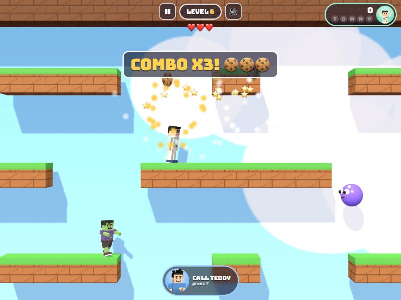
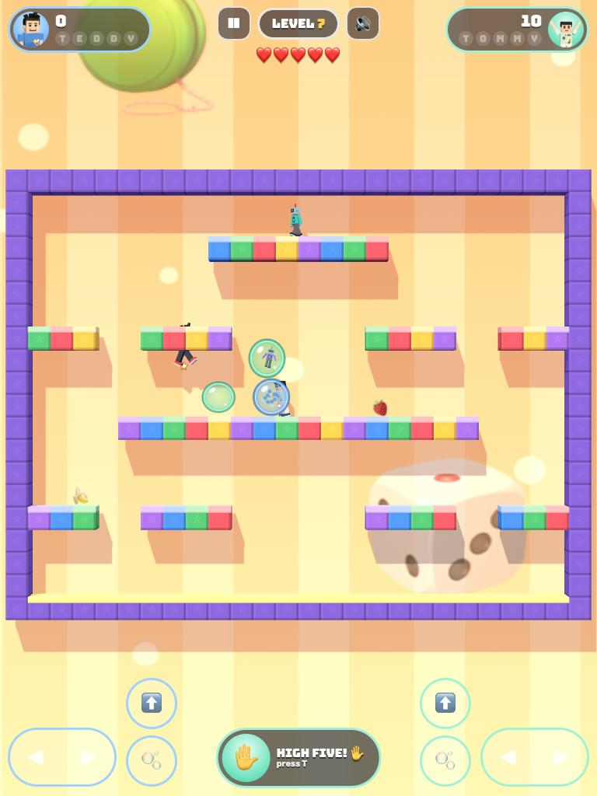
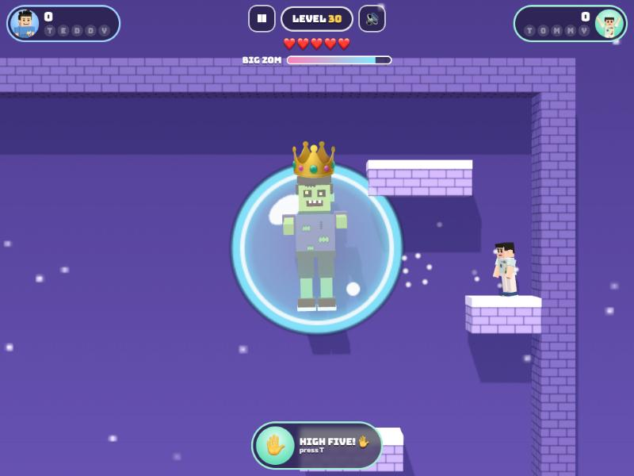
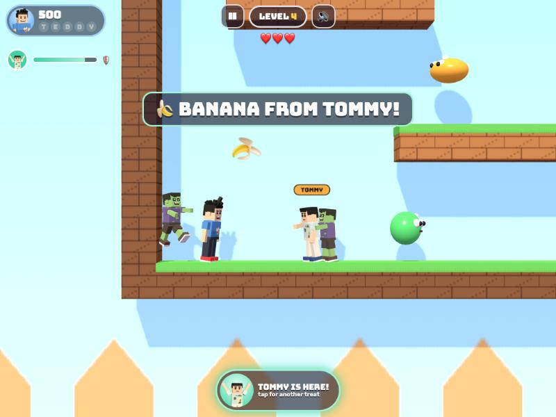
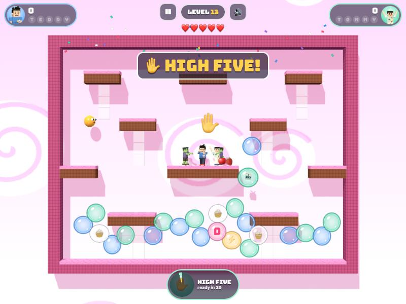

# Bubble TT (working title)

[](https://adong.github.io/bubble-tt/)

Press **?** any time (or tap the round **?** button on the left edge) to see the keys. The game waits while you look.
Tap **中文 / EN** under it to switch between English and 中文 (the dashboard and every game remember the choice).

A single-screen bubble-blowing platformer starring Teddy and Tommy, built with Claude Code from plain JavaScript and
Three.js. Blow a bubble at a silly zombie, robot or bouncy blob, and he's stuck inside, wiggling. Pop the bubble and he
turns into fruit and treats. Pop a whole bunch at once for a combo and bigger treats. Teddy blows blue bubbles and Tommy
blows mint ones. Play alone, or as a team on one keyboard or one iPad.
There are no image, model or audio files: the people are the shared kit's blocky characters, every texture is painted
on a canvas, and every sound is synthesised.



## Play

- **Double-click `index.html`.** It works offline because Three.js and the kit are copied into `kit/`.
- **Send one file:** `dist/bubble-tt.html` is the whole game in one page (about 810 KB). AirDrop or email it, then open it in a browser.
- Rebuild that file after any edit: `python3 kit/tools/bundle.py . --name bubble-tt`
- The two fonts load from Google Fonts when online. Offline, the game falls back to Arial Black and the system font.
- The name lives in one constant, `BT.TITLE` in `js/title.js` (and the page `<title>` in `index.html`).

| | Keys | Touch |
|---|---|---|
| **2 players**: Teddy | A D walk, W jump, F bubble | the blue-edged pad and buttons on the left |
| **2 players**: Tommy | ← → walk, ↑ jump, L bubble | the mint-edged pad and buttons on the right |
| **1 player** | A D or ← →, W ↑ or Space to jump, F L or X to blow | ◀ ▶ pad on the left, ⬆️ and 🫧 on the right |
| call your brother (1 player) / high five (2 players) | T or Enter | the big round button at the bottom middle |
| pause / sound | P or Esc / M | ❚❚ / 🔊 at the top |

On the title screen: Enter starts one player as the brother you picked last (← → to switch), 2 starts two players,
E switches easy mode. Holding the bubble button keeps blowing bubbles, about three a second.

## How it works

- **Pick a brother** (1 PLAYER) or **2 PLAYERS**, 🐣 EASY or 🔥 NORMAL, and a starting level. Behind the title the
  brothers play the first levels by themselves.
- **Each level is one screen.** Jump up through any platform from below and land on top; only the side walls are solid.
  A jump goes about 4.9 tiles up, enough to reach the platform 4 rows above. Some floors have holes: fall through one
  and you drop back in from the top.
- **Blow a bubble**: it shoots forward about 5 tiles, then floats up and collects under the ceiling. An enemy it hits
  on the way out is trapped and wiggles inside.
- **Pop trapped bubbles** by touching them or jumping on them. Each enemy becomes a treat that bounces onto a platform;
  walk over it for points. When the last enemy is gone, the leftover treats fly to you, and the brothers celebrate:
  Teddy alternates his Tyson-style **boxing** combo and his **jump shot** (a 🏀 flies off), Tommy does his **Y pose**
  with peace fingers. Then the next level fades in.
- **Combos:** a popped bubble pops every bubble touching it a moment later, so a cluster goes in a chain. Every enemy in
  the chain becomes a bigger treat:

  | enemies in the chain | each one becomes | points each |
  |---|---|---|
  | 1 | 🍌 🍎 🍒 🍓 | 100 |
  | 2 | 🍉 🍇 🍑 | 200 |
  | 3 | 🍪 🍩 🧁 | 500 |
  | 4 | 🍦 🍰 | 1,000 |
  | 5 or more | 🎂 | 2,000 |

  
- **Bounce on bubbles:** land on an empty bubble from above and you boing up off it (higher if you hold jump), the
  classic trick for reaching high places. Touching an empty bubble any other way pops it (10 points).
- **Wait too long** (about 10 s, shorter in later levels) and a trapped enemy escapes, angry: red-faced, 💢, and
  faster. The bubble flashes red first.
- **Getting touched by an enemy** is a dizzy flop: you fall on your back under circling stars, lose a heart, and pop
  back up at your start spot blinking (safe for 3 s). Nothing scary, nobody gets hurt. Out of hearts shows "OH NO!"
  with **KEEP GOING!**, which restarts the level with full hearts and keeps your score.
- **Hurry up:** after about 55 s on a level (40 s near the end, 80 s on easy) "HURRY UP!" pops up, the enemies get
  angry (not on easy), and 5 s later the **tickle ghost** 👻, a harmless ghost in a bubble, floats after you. If it
  catches you, you wobble and giggle for a moment ("TICKLE!"); no heart is lost.
- **Special bubbles** float up from the floor every 12–17 s:
  - **Letters**: collect T-E-D-D-Y (Teddy) or T-O-M-M-Y (Tommy), shown under your score. The whole name gives
    +1 ❤️, 5,000 points and a rain of treats. Letters are kept from level to level.
  - **💧 Water** (from level 5): a wave runs along the platforms in the direction you face, falls off edges, and
    washes every enemy it touches into treats (bigger and bigger treats, like a combo).
  - **⚡ Star lightning** (from level 8): zaps across the screen in the direction you face and turns everyone in its
    row into treats.
- **Hearts:** 3 in one-player normal, 5 on easy; the brothers share 5 (8 on easy) in two players. A completed name, and
  every 30,000 points (then 60,000), give another heart. If one brother runs out of shared hearts the other keeps going,
  and both are back for the next level.
- **Easy mode** (🐣): slower enemies (68%), trapped enemies stay in their bubbles longer (14 s instead of 10),
  more hearts, a later and gentler hurry-up, and a weaker boss.
- **Progress:** the furthest level reached (for easy and for normal), the best score, your brother and easy mode are saved in the
  browser (`localStorage` key `bubbleTT.v1`), so `index.html` and the single page each keep their own.
  "open every level" on the level screen unlocks them all.



### The boss

Level 30 is **Big Zom**, a giant cartoon zombie with a crown, bouncing around inside a bubble shield. Every bubble
that hits the shield takes a bit off his bar (34 hits, 22 on easy), and lightning bubbles float up all the time for
big zaps. Now and then he sneezes out a little blob. When the shield is gone he's stuck in a giant bubble that drifts
over to you: pop it for a 🎂 worth 10,000 and a shower of treats, then "YOU BEAT BIG ZOM!".



## The companion

Alan's rule for every game: the other brother can always be called in.

- **1 player:** press **T** (or Enter) or tap the big round button with his face, as often as you like. Your brother
  floats down in a big bubble right next to you, with his name tag:
  - he says hi with his signature move (Tommy's Y pose, Teddy's boxing) and throws you a treat that arcs into your
    hands, one of 🍦 💧 🧃 🍪 🍉 🍌 ("🍦 ICE CREAM FROM TOMMY!", +500);
  - then he plays alongside you for about 10 s with the same autopilot the level check uses: he blows bubbles at
    enemies and pops the trapped ones, and everything he earns goes to your score and your letters;
  - while he's there, **one hit on you is blocked**: a bubble shield bursts around you and "TOMMY SAVED YOU!" pops up;
  - a bar with his face under your score shows the time left (with 🛡️ while the save is still unused);
  - tapping again while he's there gives another treat, refills his time and his save;
  - then he waves goodbye (Tommy's Y again, Teddy's jump shot) and floats back up in his bubble.

  

- **2 players:** the button (or T / Enter) is a **high five**: both brothers stop for their signature moves (Teddy's
  boxing, Tommy's Y), a big ✋ appears, and the screen fills with bonus bubbles: 16 empty ones to bounce on and pop,
  3 treat bubbles, a lightning bubble and a letter. Then it needs 20 s to charge again (the button shows a clock).

  

## The levels

Five worlds of six levels: the backyard, the toy room, candy land, space and the moon castle. The difficulty creeps
up slowly: more and quicker enemies, a little less time before trapped enemies escape and before the hurry-up.

| # | Level | New idea |
|---|---|---|
| 1 | Hello, Bubbles! | three slow zombies, blow and pop |
| 2 | Up, Up, Up! | jumping up through platforms |
| 3 | Bubble Ladder | bouncing on your own bubbles |
| 4 | Bouncy Blobs | blobs bounce, catch them in the air |
| 5 | Holes in the Floor | wrap-around: drop through the floor, fall in from the top; water bubbles start |
| 6 | Backyard Party | six enemies, combos |
| 7 | Robot Friends? | quicker robots |
| 8 | Block Tower | a pyramid; lightning bubbles start |
| 9 | Toy Stairs | a staircase of small steps |
| 10 | Flying Robots | zig-zagging flying robots |
| 11 | Toy Train | stacked "train cars" |
| 12 | Toy Box | enemies hiding inside a box |
| 13 | Lollipops | candy platforms on sticks |
| 14 | Candy Canes | hooks and side ledges |
| 15 | Gumdrops | five blobs |
| 16 | Cupcake | climb to the cherry on top |
| 17 | Sugar Rush | seven enemies |
| 18 | Candy Castle | crenellations |
| 19 | Moon Walk | big holes in the floor |
| 20 | Rocket | a rocket in the middle |
| 21 | UFO | Tommy's favourite: a flying saucer and its beam |
| 22 | Star Field | tiny platforms |
| 23 | Planets | rings of platforms |
| 24 | Space Station | holes and side ledges |
| 25 | Castle Gate | into the moon castle |
| 26 | Towers | up and down towers |
| 27 | Zigzag | a zig-zag climb |
| 28 | The Big Heart | a heart in the background |
| 29 | T and T | two big Ts, for Teddy and Tommy |
| 30 | Big Zom | the boss |

## Editing levels

Every level is an ASCII map in `js/levels.js`: 20 rows of 26 characters, ceiling first.

```
'##########################',   # block (jump up through it, land on top)
'#                        #',   + background decoration, no collisions
'#       z        z       #',   1 2  Teddy's and Tommy's start spots
'#   ##################   #',   z zombie, r robot, b blob, d flying robot, B Big Zom
...                              a space in the top or bottom row is a hole
'# 1                    2 #',
'##########################',
```

Each level also has a `name` and a `tip` (shown before it starts) and can set `gather` (where floating bubbles collect
under the ceiling), `hurry` (seconds before "HURRY UP!") and `trap` (seconds a trapped enemy stays in his bubble).
Platforms 4 rows apart can be reached by jumping straight up; a kid needs 2 empty rows above anything he stands on.
After editing, run the check:

```bash
node tools/check.js
```

## Proving every level can be finished

`tools/check.js` loads the same rules the game uses (`js/sim.js`, no Three.js) and checks every level in about a second:

1. **Map rules:** the size, solid side walls, nothing starts inside a block or in mid-air, head room above every
   platform, and every hole in the floor has a hole in the ceiling above it.
2. **Reachability:** it builds the jump graph (every spot you can stand on, joined by walks, jumps and drops simulated
   with the real physics) and checks that every spot can be reached from both start spots.
3. **Play-through:** the autopilot plays every level five times (one player with three seeds, two players, easy) and
   must clear it. Enemies can't hurt the autopilot here, so this proves a level can be cleared, not that it's easy.
4. **The check can fail:** standing still for 90 s never clears a level, and six broken maps (an enemy inside a block,
   one in mid-air, a ledge too high to reach, no head room, a short row, a missing wall) must all be caught.

Last run: all 30 levels pass, cleared in 4–41 s by the autopilot (the boss in 31–91 s), all six broken maps caught.
`node tools/check.js 7 --trace` shows level 7 alone with the autopilot's moves.

Test hooks for the browser (the Browser pane throttles animation when hidden, so tests drive the game themselves):
`game.step(seconds)` ticks and draws synchronously, `game.keepAwake()` stops the pause when the page is hidden,
`game.start(level, '1p' | '2p', hero, easy)`, `game.press('KeyF')` / `game.press('KeyF', false)`,
`game.touch('L', 'jump')`, `game.call()`, `game.autopilot()`, `game.peek(x, y, zoom)` (close-up camera),
`game.check(level)` (the play-through in the browser), `game.calm()` (no CSS animations) and `game.state()`.
`index.html?level=12&mode=2p` (or `&hero=tommy&easy=1`) opens a level directly.

## Files

```
index.html       page, HUD, touch controls and screens (CSS inline)
js/title.js      the game's name (one constant)
js/sim.js        the rules: physics, bubbles, chains and combos, enemies, treats, letters, water, lightning,
                 hurry-up ghost, the boss, the companion and high five, the jump graph and the autopilot;
                 no Three.js, so it also runs in Node
js/levels.js     the 30 levels (ASCII maps), their names and tips
js/art.js        the five worlds' colours and canvas-painted textures (blocks, grass/frosting caps, backdrops, bubbles)
js/view.js       the Three.js scene: builds each level, the kids, enemies, Big Zom, bubbles, treats and effects
js/poses.js      extra poses on top of Kit.people.pose (stand, blow, dizzy, kick, cheer)
js/sfx.js        sounds made with Kit.sound.tone / hiss (blub, pop, boing, combo, zap, splash, giggle...)
js/game.js       screens, keyboard and touch, HUD, companion button, toasts, saving, title demo, test hooks
js/keys.js       the keys the ? panel shows (Kit.help)
js/zh.js         中文: every word on the page, the level and world names and tips, the ? panel (Kit.lang)
tools/check.js   the level check (node tools/check.js)
kit/             copy of ~/claude-games/kit (python3 ../kit/tools/sync.py .); don't edit it here
docs/            screenshots
dist/bubble-tt.html   the single-page build
```

## Kit candidates

Written here first; worth moving into `~/claude-games/kit` if another game wants them:

- **Bubble texture** (`bubbleTexture` in `js/art.js`): a soap bubble in any tint, optionally with a letter or emoji inside.
- **Jump graph + autopilot** (`buildNav` and `Bot` in `js/sim.js`): simulate walks, jumps and drops with the real
  physics to find every spot a kid can stand on and how to get there, then follow it. Useful for any platformer's
  companion, title demo and "is every level clearable" check.
- **Poses** (`js/poses.js`): `blow`, `dizzy` (on his back, waggling), `kick` (paddling inside a bubble).
- **Latched taps** (`tapped` in `js/game.js`): a key or button pressed and released between two frames still counts.

## Not verified

- **Sound:** every effect is wired to the kit, but nobody listened in this build (the test browser has no audio check).
- **Real touch devices:** touch was tested with simulated input at iPad and phone sizes in the Browser pane, not on a real iPad.
- **Real kids:** the difficulty, the hurry-up timings and how fast trapped enemies escape are guesses until Teddy and Tommy play it.
